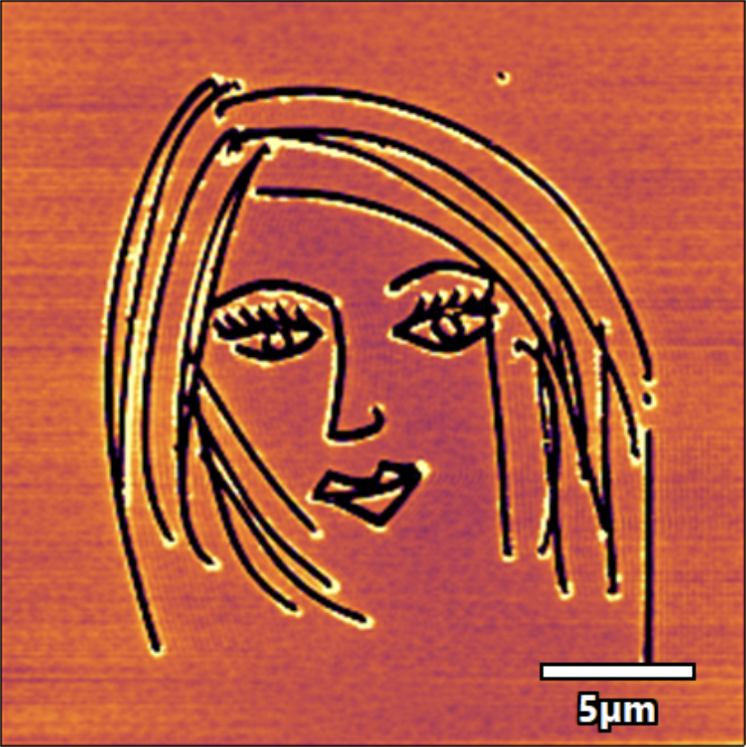
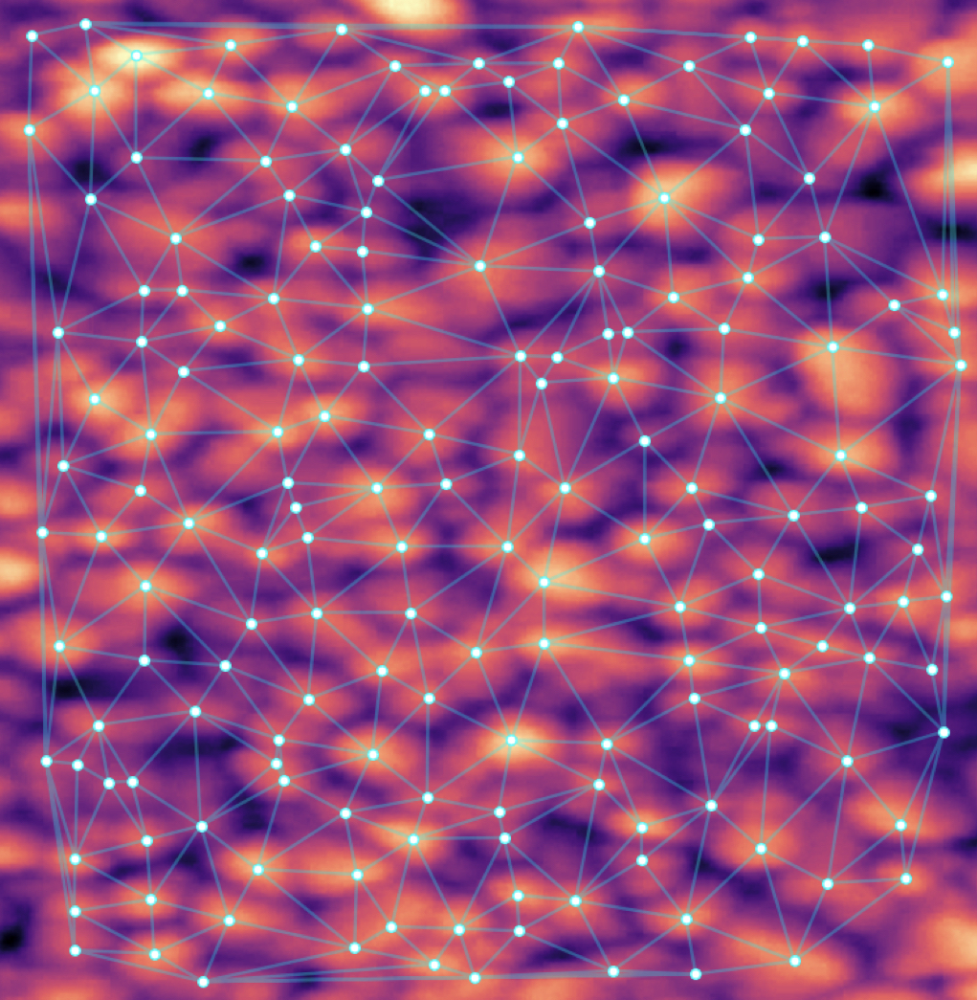

# Hi, I'm Sinny

**Physicist working at the meeting point of nanomaterials, data and science communication.**

I live in Dublin, grew up in Ahmedabad, did all my physics degrees at Gujarat University, and somewhere along the way I also became a Montessori teacher. I study how materials behave at the nanoscale, from thin films to carbon nanotubes, and I like turning messy experimental data into clear, defensible results. I'm now applying that experience to research impact, evidence and data-driven work.

So I spend my time between nanotubes and 9 to 12 year-olds, and honestly the two have more in common than you'd think: both reward patience and curiosity.

### Interesting things I've been working on lately

As a postdoctoral researcher in the UCD School of Physics, I spent my time watching carbon nanotubes line up in an electric field and then slowly drift back to random once the field is off. Different-sized tubes do this at different speeds, and that difference tells you something about their shape without having to destroy the sample. I presented this at **Electroceramics XX in Novi Sad, Serbia, this October**, and I'm continuing the work as an Adjunct Fellow in the same group, writing it up as a paper.

- **Carbon nanotube electro-optics:** a non-destructive method for probing the aspect ratio and anisotropy of multi-walled carbon nanotubes, using AC-field alignment and Brownian relaxation tracked by transmitted light
- **Nanoscale characterisation:** conductive AFM analysis for energy materials at UCD Conway Institute, including FeNiB electrocatalysts (*Sustainable Energy & Fuels*, 2024)
- **Thin-film nanostructures:** PhD research in materials physics, Gujarat University

### Why I'm on GitHub

Lab work gave me a lot of raw data and a lot of opinions about cleaning it. I'm building up my data skills properly now (currently doing the Google Data Analytics certificate), honing my AI skills, and exploring science illustration. This is where I'll keep that work.

### 🎨 Things I've made

**Nano-Carving on a Hafnia Canvas**

As a visiting researcher in the Nanoscale Function Group at UCD Conway Institute, I was trying to scratch circular electrodes onto a hafnia film with an AFM tip, and the diamond tip just wouldn't behave. So I took a break and drew a face instead. After that, the electrodes started coming out fine. The whole portrait is narrower than a human hair. (My entry to the UCD Research Images Competition, September 2025.)

**Nano-Constellation: AFM data through an AI/ML lens** ([code](https://github.com/ansi111-a/nano-constellation))

At the UCD Interdisciplinary Hackathon, I analysed an AFM scan of TiO₂ particles: normalised the image, detected individual particles with peak local maxima, joined them into a mesh using Delaunay triangulation, and viewed it in 3D to see where the spacing between particles varied and how that matched the surface topography. Connecting the peaks looked a lot like joining stars into a constellation, which is where the name came from.

### 🌱 Beyond the lab

I care about getting kids excited about science.

- CuriosiTY facilitator at UCD Conway Institute
- Co-organiser of *Science Starts Small* (primary school outreach) and Pint of Science Dublin
- AMI Montessori Diploma (Elementary), so I care a lot about explaining science step by step

### 📚 Research record

8 peer-reviewed publications · 108 citations · h-index 7

### 📫 Say hello

- ORCID: [0009-0003-8756-3796](https://orcid.org/0009-0003-8756-3796)
- LinkedIn: [sinny-trivedi](https://www.linkedin.com/in/sinny-trivedi-72a1851a)
- Email: sinny.j.trivedi@gmail.com
